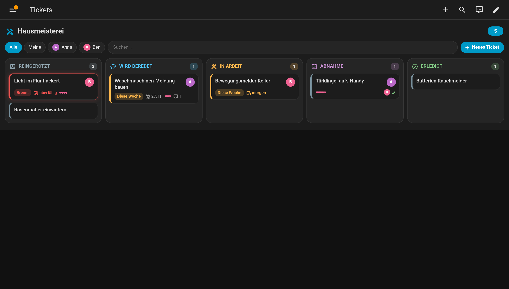
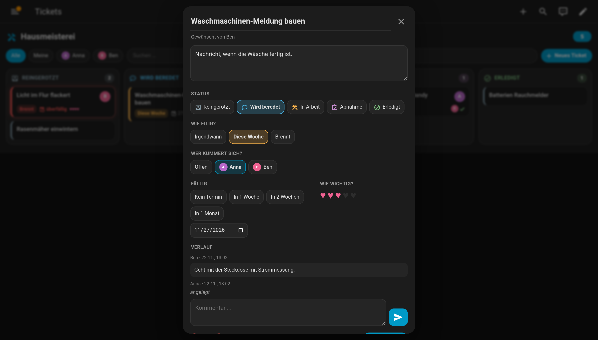
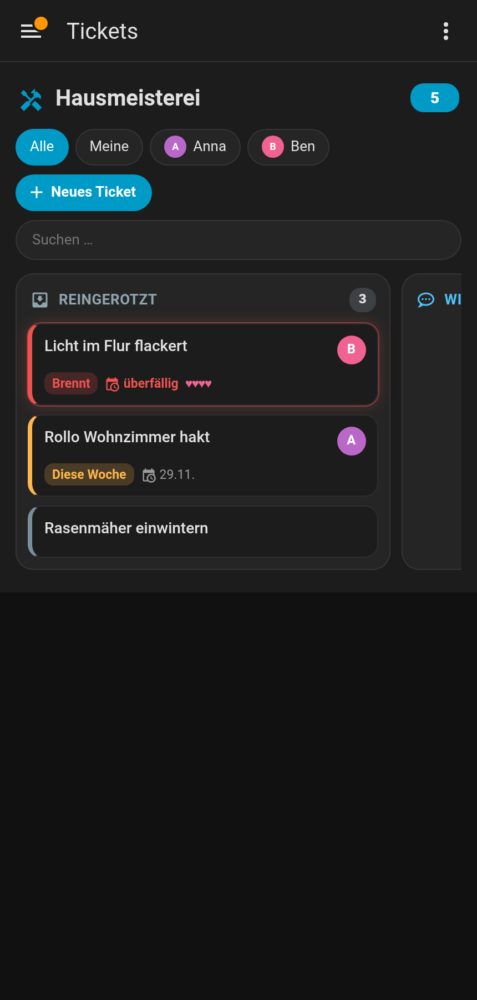
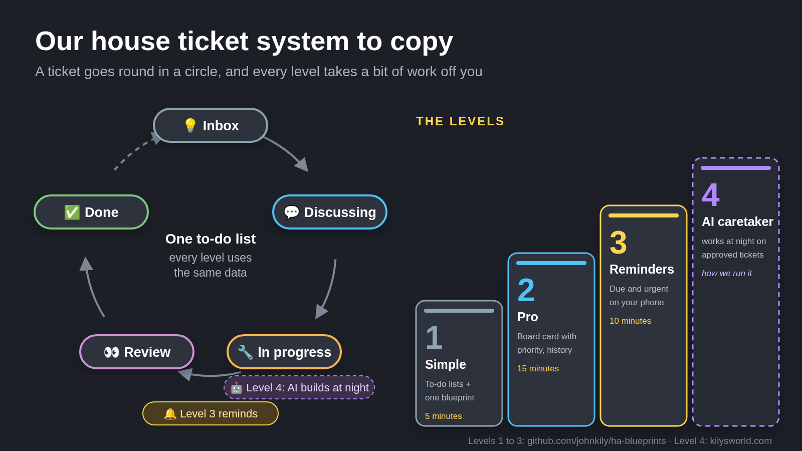

# Ticket Board Card for Home Assistant

A Kanban board for everything that needs doing around the house. Wishes and tasks become tickets in five columns, and you see at a glance who takes care of what, what's urgent and what's due.

**The tickets live in a normal Home Assistant to-do list.** No integration, no scripts, no `configuration.yaml`. Everything is part of every backup, and you can still see the list in the HA app or add items by voice.

*[Deutsch weiter unten](#deutsch)*



## Features

- Five columns: Inbox → Discussing → In progress → Review → Done (drag & drop with mouse or finger)
- Priority (“someday”, “this week”, “burning”), assignee with profile picture, due date, hearts for “how important is this to me”
- Filters “All”, “Mine”, per person, and a search
- Ticket dialog with history (who changed what and when) and comments
- “Done” also ticks the item in the to-do list, and ticking it in the app moves it to Done
- German and English, follows the Home Assistant language
- Works on the phone: swipe through the columns

| Ticket dialog | On the phone |
|---|---|
|  |  |

## Installation

### Marketplace (formerly HACS)

[](https://my.home-assistant.io/redirect/hacs_repository/?owner=johnkily&repository=ticket-board-card&category=plugin)

Or by hand: *Settings → Marketplace → ⋮ → Custom repositories* → `https://github.com/johnkily/ticket-board-card`, type **Dashboard**. Then install **Ticket Board Card** and reload the browser or app.

### Manual

1. Download [`ticket-board-card.js`](ticket-board-card.js) and copy it to `/config/www/`.
2. *Settings → Dashboards → ⋮ → Resources → Add resource*: URL `/local/ticket-board-card.js?v=1`, type **JavaScript module**.
3. Reload the browser or app. For a new version, replace the file and increase the number after `?v=`.

## Setup

1. *Settings → Devices & services → Add integration* → **Local To-do** → e.g. “Tickets”. That gives you `todo.tickets`.
2. Edit a dashboard → *Add card* → **Ticket-Board** (or *Manual*):

```yaml
type: custom:ticket-board-card
entity: todo.tickets
title: Our house
people:
  - person.anna
  - person.ben
```

| Option | Required | Description |
|---|---|---|
| `entity` | yes | The to-do list that holds the tickets |
| `title` | no | Heading of the card |
| `people` | no | Persons you can assign tickets to and filter by |
| `archive` | no | How many done tickets stay visible (default 6) |

The German option names `titel`, `personen` and `archiv` work as well.

The card fits best in a **panel** view or a full-width section.

## Make it smarter: the levels



The card is level 2 of our house ticket system. Two blueprints from [johnkily/ha-blueprints](https://github.com/johnkily/ha-blueprints) go with it:

- **Level 1 – simple board without this card:** two or three to-do lists, ticking an item moves it on.
- **Level 3 – reminders:** a morning message with due and overdue tickets, reviews that have been waiting for days and urgent tickets nobody touches. Every assignee gets their own tickets on their phone, new urgent tickets come right away.

Full guide: [ticket board guide](https://github.com/johnkily/ha-blueprints/blob/main/docs/en/ticket_board.md).

## Good to know

- **Whoever creates a ticket is saved as “requested by”.** For that, the HA user has to be linked to their person (*Settings → People*).
- **The extra data** (status, priority, history …) is stored at the end of the to-do item's description after a ⚙. Please don't edit that line by hand.
- **Photos and files** are not supported.

## Not working?

| Problem | Solution |
|---|---|
| “Custom element doesn't exist” | Resource added? Then reload the browser or app. |
| Board stays empty with an error | Is the to-do list under `entity` correct? |
| “Mine” shows nothing | Is your HA user linked to your person? |
| The old version is shown | Manual install: increase the number after `?v=`. Marketplace: reload the app. |

---

## Deutsch

Ein Kanban-Board für alles, was im Haus zu tun ist. Bei uns heißt es „Hausmeisterei“. Die Tickets liegen in einer ganz normalen To-do-Liste von Home Assistant, ohne Integration und ohne Skripte.

**Installation:** über den Knopf oben im Marketplace (früher HACS) oder von Hand wie oben beschrieben. Die Optionen heißen auf Deutsch `titel`, `personen` und `archiv`, die englischen Namen gehen genauso.

**Die ausführliche Anleitung auf Deutsch** mit allen drei Stufen (einfach, Profi, Erinnerungen) steht hier: [Ticket-Board – alles, was im Haus zu tun ist](https://github.com/johnkily/ha-blueprints/blob/main/docs/ticket_board.md). Wie wir selbst damit arbeiten, steht im Blog [Kily's World](https://kilysworld.com).

---

MIT License · made by [Kily's World](https://kilysworld.com) · if it helps you, a ⭐ helps others find it.
